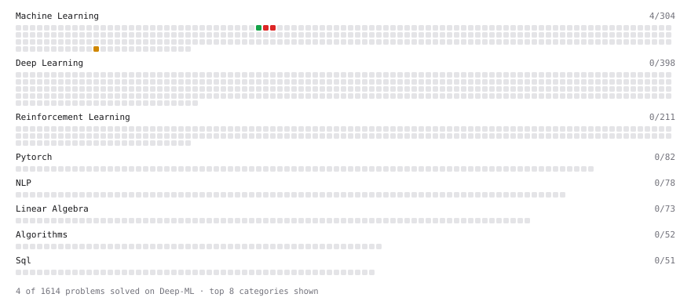

# Deep-ML

My machine learning practice from [Deep-ML](https://www.deep-ml.com). Every solution here was written by hand.

**8** solved · 8 problems · 0 labs · 0 math

[**Browse the interactive portfolio**](https://trainsn.github.io/deep-ml/) to replay this filling in over time.

## Problems

| | Difficulty | Solved | |
| --- | --- | --- | --- |
| [Binary Classification with Logistic Regression](https://www.deep-ml.com/problems/104) | easy | 2026-10-19 | [solution](problems/0104-binary-classification-with-logistic-regression) |
| [Softmax Activation Function Implementation ](https://www.deep-ml.com/problems/23) | easy | 2026-10-29 | [solution](problems/0023-softmax-activation-function-implementation) |
| [Implement Masked Self-Attention](https://www.deep-ml.com/problems/107) | medium | 2026-10-20 | [solution](problems/0107-implement-masked-self-attention) |
| [Implement Self-Attention Mechanism](https://www.deep-ml.com/problems/53) | medium | 2026-10-20 | [solution](problems/0053-implement-self-attention-mechanism) |
| [K-Means Clustering](https://www.deep-ml.com/problems/17) | medium | 2026-10-20 | [solution](problems/0017-k-means-clustering) |
| [Vectorized K-Means with Broadcasting](https://www.deep-ml.com/problems/1465) | medium | 2026-10-20 | [solution](problems/1465-vectorized-k-means-with-broadcasting) |
| [Train Logistic Regression with Gradient Descent](https://www.deep-ml.com/problems/106) | hard | 2026-10-19 | [solution](problems/0106-train-logistic-regression-with-gradient-descent) |
| [Train Softmax Regression with Gradient Descent](https://www.deep-ml.com/problems/105) | hard | 2026-10-20 | [solution](problems/0105-train-softmax-regression-with-gradient-descent) |

---

_This file is regenerated by Deep-ML on every push._
